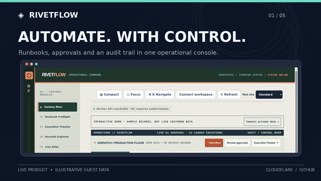
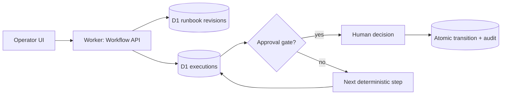

<div align="center">

# RivetFlow

### Every transition has a reason.

Workflow orchestration with accountable human decisions.

[](https://github.com/amiddlebrook/RivetFlow/actions/workflows/ci.yml) [](https://github.com/amiddlebrook/RivetFlow/actions/workflows/deploy.yml) [](LICENSE) [](docs/ZERO_COST_POLICY.md)

**[Launch application](https://portfolio-rivetflow.averymiddlebrook2014.workers.dev)** · **[▶ WATCH THE 20-SECOND DEMO WITH SOUND](https://portfolio-rivetflow.averymiddlebrook2014.workers.dev/showcase/index.html)** · [Architecture](docs/ARCHITECTURE.md) · [Security](docs/SECURITY.md) · [Roadmap](docs/ROADMAP.md)

[](https://portfolio-rivetflow.averymiddlebrook2014.workers.dev/showcase/index.html)

*The preview loops silently on GitHub. **Click the animation to watch the full 20-second version with spoken narration and sound in your browser**—no download or account required. Real public Cloudflare UI captures with illustrative guest-mode records; no paid AI execution is claimed.*

</div>

---

## The problem

Drawing a workflow is easy. Operating it safely is harder: which runbook revision did a run use, can an approval be repeated, and what happens after an interrupted step? RivetFlow makes those boundaries explicit with versioned definitions, idempotent transitions, human approval gates, and inspectable recovery state.

**RivetFlow** is an engineering platform for accountable workflow orchestration. Its primary audience is **Operations engineers automating bounded, high-stakes processes**. Build runbooks, start an execution, stop for approval, and trace what happened.

> [!IMPORTANT]
> **Production-deployed engineering portfolio project, not an audited enterprise SaaS.** The Worker, D1-backed API, access-control tests and deployment checks are operational. Single-workspace database ownership is enforced. This is **not** multitenant SSO, third-party security certification, a validated production D1 restore, or an unlimited-cost-free SLA.

## See it work

**[▶ Play the full narrated 20-second product demo (sound + captions)](https://portfolio-rivetflow.averymiddlebrook2014.workers.dev/showcase/index.html).** The animation above remains an autoplaying preview. GitHub cannot attach audio to GIFs; the linked player has native video and audio controls.

**[↗ Try the live guest demo](https://portfolio-rivetflow.averymiddlebrook2014.workers.dev)** · [Storyboard and reproduction](docs/BRAG_DEMO.md) · [Optional high-resolution MP4](docs/media/brag.mp4)

RivetFlow starts with an illustrative, read-only guest experience. **Authenticated operations require the administrator's API credential**; the README does not publish or distribute access keys.

### The end-to-end path

1. Author a runbook with deterministic stages and approval gates.
2. Publish a revision; new runs retain their own definition snapshot.
3. Launch a run with a unique idempotency key.
4. Execute bounded steps; pause at human decisions rather than assuming consent.
5. Resolve or reject approval; inspect the committed cursor and audit event.

## Engineering highlights

| Capability | Design decision |
|---|---|
| **Runbook revisions** | Running executions retain a snapshot; edits cannot rewrite history. |
| **Atomic approvals** | A decision, execution transition and audit record succeed or fail together. |
| **Guarded execution** | Uncertain AI steps are not automatically retried as if they were safe. |
| **Operator control room** | Execution history, approval queue, recovery and decision workspaces. |

## Architecture



**Frontend:** responsive JavaScript/CSS on Cloudflare Workers static assets.  
**API:** TypeScript Cloudflare Worker with validated, scoped endpoints.  
**Persistence:** a dedicated Cloudflare D1 database for this single-workspace application.  
**Automation:** GitHub Actions for tests, migration integrity, live Cloudflare deployment, authenticated smoke checks and Chromium browser verification.  
**AI inference:** optional Workers AI, disabled in production by default; budget enforced if deliberately enabled.

**The engineering emphasis:** Run definition snapshots, idempotency-key validation, transactional approval triggers, bounded deterministic advancement, recovery-state inspection.

## Run your own instance

**Requirements:** Node.js 22+, npm, a GitHub account and a Cloudflare account with available Free-plan capacity.

```bash
git clone https://github.com/amiddlebrook/RivetFlow.git
cd RivetFlow
npm ci
npm run check
npm test
npm run db:local
npm run dev
```

Open the local URL printed by Wrangler. Local development uses a **local D1 instance**, not the live portfolio database. To deploy your own environment, create a unique D1 database, configure `wrangler.jsonc` to reference **your own account and database**, set a secret administrator token with `wrangler secret put ADMIN_TOKEN`, run `npm run db:remote`, then `npm run deploy`. **Never reuse the portfolio project's deployment target or publish secrets.**

Production deployments require the account's GitHub Actions repository secrets for Cloudflare authentication and the application administrator; see [`docs/OPERATIONS.md`](docs/OPERATIONS.md) and [`docs/SECURITY.md`](docs/SECURITY.md).

## Verification and operational controls

| Gate | Command or workflow | What it establishes |
|---|---|---|
| TypeScript and syntax | `npm run check` | Type soundness and frontend syntax |
| Domain and security tests | `npm test` | Isolated SQLite/D1-style integration and negative cases |
| Reproducible build | `npm run verify:release` | Locked dependencies, migration and asset integrity |
| Database restore drill | `npm run verify:recovery` | Synthetic schema/data backup→restore integrity |
| Scoped live credentials | `npm run verify:auth-live` | Production key creation, restriction and revocation |
| Live browser acceptance | `npm run verify:browser` | Cloudflare desktop/mobile guest and authenticated navigation |
| Edge latency sample | `npm run verify:edge` | 24 bounded read-only health requests; **not** a load SLA |

Every push to `main` triggers GitHub CI and Cloudflare deployment. Production-release checks include a dedicated Worker/D1 ownership fence, scoped credential lifecycle, free-tier budget policy, browser screens, and restoration rehearsal. [Inspect the deploy workflow](.github/workflows/deploy.yml).

## Zero-cost operating model

This repository uses **only free-tier-compatible Cloudflare and GitHub services** and adds application-level daily quotas. Remote AI is disabled by default. When a supported quota is exceeded, the operation is rejected rather than silently falling back to a paid service. Cloudflare's provider-side allocations are shared across the account where applicable; **unlimited use for $0 is not promised**. [Quota design and limitations](docs/ZERO_COST_POLICY.md).

## Security boundaries and trade-offs

- Each product has its own Worker, database binding and immutable runtime workspace ownership record.
- Private API routes require an administrator credential or appropriately scoped, expiring delegated key; credentials are never embedded in the frontend.
- Revocation, approvals and other security-critical transitions are guarded by atomic SQLite state changes and audited where implemented.
- The public guest experience displays **illustrative data**, not real customer information.
- **Out of scope today:** Single-workspace operations service; no claim of exactly-once external integrations. Production restoration from real customer data and third-party penetration testing have not been demonstrated.

See the explicit [security model](docs/SECURITY.md), [architecture trade-offs](docs/ARCHITECTURE.md) and [production-readiness backlog](docs/ROADMAP.md).

## Repository map

```text
public/         Distinctive product interface, styles and static assets
src/            Cloudflare Worker, domain APIs, security and free-tier policy
migrations/     Versioned D1 schema and transactional safeguards
tests/          Domain regression, security and contract tests
scripts/        Release checks, browser verification and BRAG video renderer
.github/        CI, Cloudflare deployment and demo publication workflows
docs/           Architecture, operations, decisions, media and demos
```

## What's next

- [ ] Long-lived Cloudflare Workflows with timeout supervision
- [ ] Transactional outbox for real connectors
- [ ] Role-scoped human approvals and identity integrations

**License:** [MIT](LICENSE). **Demo method:** [BRAG-slim](https://github.com/latent-spaces/brag/tree/main/skills/brag-slim), using actual guest UI captures and a reproducible, no-paid-service video renderer. [Full video](docs/media/brag.mp4).
